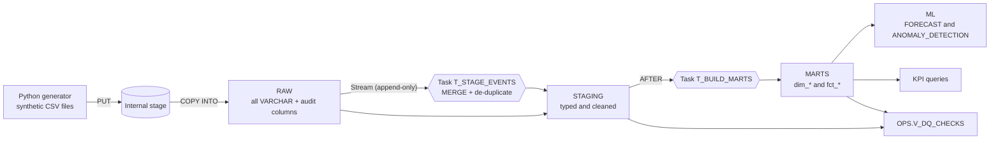
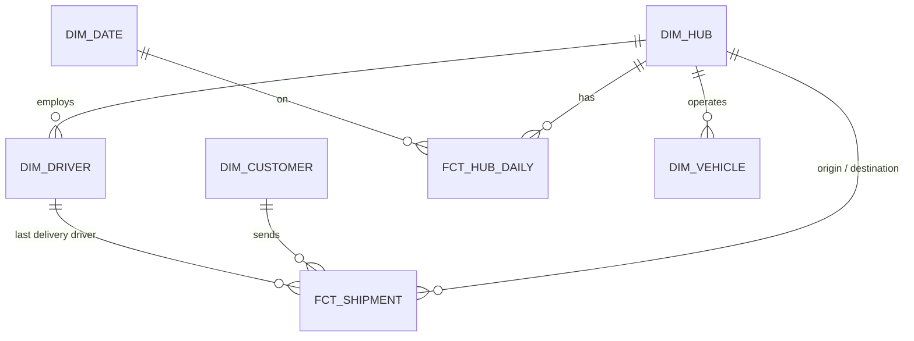

# Snowflake Logistics Pipeline

An end-to-end data engineering and ML project on Snowflake, modelled on a Romanian parcel-delivery network.
Raw scan events flow through a layered pipeline (RAW → STAGING → MARTS), are orchestrated with streams and tasks,
checked by data-quality rules, and finally used to **forecast hub volume** and **detect abnormal delivery delays**
with Snowflake's built-in ML functions, all in SQL.

## Business questions

| Question | Answered by |
|---|---|
| How many parcels will each hub handle in the next 14 days, and will it exceed capacity? | `SNOWFLAKE.ML.FORECAST` + `ML.V_CAPACITY_RISK` |
| On which days and in which hubs did late deliveries spike abnormally? | `SNOWFLAKE.ML.ANOMALY_DETECTION` |
| What is our on-time rate, first-attempt success rate and transit time, by service level, hub, customer? | `MARTS.FCT_SHIPMENT`, `MARTS.FCT_HUB_DAILY` |
| Do cash-on-delivery (COD) parcels fail more often? Why do deliveries fail? | `sql/07_analytics_queries.sql` |
| Is the data trustworthy after every load? | `OPS.V_DQ_CHECKS` |

## Architecture



| Layer | Schema | What lives there |
|---|---|---|
| Landing | `RAW` | Files loaded as-is. Every column is `VARCHAR`, plus `_SOURCE_FILE` and `_LOADED_AT`. |
| Cleaned | `STAGING` | Typed with `TRY_` functions, trimmed, de-duplicated. Events are merged incrementally from a stream. |
| Business | `MARTS` | Star schema: `DIM_HUB`, `DIM_CUSTOMER`, `DIM_DRIVER`, `DIM_VEHICLE`, `DIM_DATE`, `FCT_SHIPMENT`, `FCT_HUB_DAILY`. |
| ML | `ML` | Forecast and anomaly-detection models, their outputs, and business views on top. |
| Operations | `OPS` | Stored procedures, task DAG, pipeline run log, data-quality view. |

## The data

The data is **synthetic but built to behave like a real network**. A Python script (standard library only, deterministic
with `--seed`) simulates 10 hubs, 60 B2B customers, a fleet, drivers and the scan events of every parcel.

| | |
|---|---|
| Period | 180 days, 2025-10-01 to 2026-03-29 |
| Volume | ≈ 97,000 shipments, ≈ 660,000 scan events |
| Event types | `CREATED`, `PICKED_UP`, `HUB_INBOUND`, `HUB_OUTBOUND`, `OUT_FOR_DELIVERY`, `ATTEMPT_FAILED`, `DELIVERED`, `RETURNED_TO_SENDER` |

Realistic behaviour that the pipeline and the ML models have to deal with:

- **Seasonality:** almost no Sunday volume, a Black Friday peak (≈ 2.4× a normal weekday) and a pre-Christmas ramp-up.
- **Capacity:** every hub has a daily capacity, sized from the volume that really starts there. Parcels that start on a day when their hub is above ~90 % of capacity are likely to be delayed, so a peak shows up in on-time rates.
- **Delivery reality:** up to 3 attempts, then return to sender. COD ("ramburs") and peripheral destinations fail more often.
- **Winter disruptions** on the linehaul network.
- **Intentional data-quality problems**, to be handled by the pipeline:
  - ~0.4 % of events are **duplicated** (same `event_id` twice),
  - ~0.3 % of events **arrive late** (in a file 1-3 days after they happened),
  - the extract ends mid-flight, so some parcels are still **in transit**.

No personal data is used: recipients are only a city and a zone, and all names are randomly generated.

## Key design decisions

- **RAW is all `VARCHAR`.** A bad value must never make a file fail to load. Typing happens in STAGING with `TRY_TO_*`, so errors become `NULL` and are caught by data-quality checks.
- **Idempotent loading.** `COPY INTO` keeps a per-file load history, so re-running a load never duplicates files. If a file *is* force-reloaded, the staging `MERGE` still de-duplicates on `event_id`.
- **Streams + tasks for the big table.** `STRM_RAW_SHIPMENT_EVENTS` captures new rows; `T_STAGE_EVENTS` runs only when the stream has data (`WHEN SYSTEM$STREAM_HAS_DATA`), so an idle pipeline does not start the warehouse.
- **Stored procedures behind the tasks.** Logic lives in `SP_STAGE_EVENTS` and `SP_BUILD_MARTS`, so every step can be run and tested by hand, and each run writes to `OPS.PIPELINE_RUN_LOG`.
- **Marts are rebuilt in full.** A deliberate trade-off at this size: simple, always consistent, and it absorbs late events for free. At larger scale this becomes an incremental `MERGE` or a `DYNAMIC TABLE`.
- **Late events are safe.** Shipment milestones are computed with `MIN/MAX` over event timestamps, not over arrival order.
- **Data quality is code.** `OPS.V_DQ_CHECKS` returns PASS/FAIL per rule, plus informational counts for the known issues (duplicates removed, late events, in-transit parcels).
- **Cost control.** `XSMALL` warehouse with 60 s auto-suspend, a resource monitor (10 credits/month), and tasks that are suspended after demos.
- **Least privilege.** Everything is owned by a dedicated `LOGISTICS_ENGINEER` role instead of `ACCOUNTADMIN`.
- **Honest ML evaluation.** The forecast is first backtested on a 14-day hold-out and reported with WAPE and prediction-interval coverage before the production model is trained. WAPE is used instead of MAPE because Sundays have near-zero volumes.

## Data model



- `FCT_SHIPMENT`: one row per parcel, with its lifecycle pivoted from events (picked up, out for delivery, delivered/returned), attempts, status, `IS_ON_TIME`, `DAYS_LATE`, `TRANSIT_HOURS`.
- `FCT_HUB_DAILY`: one row per hub per day on a complete date spine, with volume, capacity utilisation, on-time rate and failed attempts. It feeds the ML models.

## Repository layout

```
.
├── data_generator/generate_data.py   # synthetic data (Python standard library only)
├── tests/test_generator.py           # 13 unit tests for the generator
├── scripts/snowsql_upload.sql        # PUT files to the internal stage
├── sql/
│   ├── 00_setup.sql                  # warehouse, resource monitor, role, database, schemas
│   ├── 01_raw_tables_and_load.sql    # file format, stage, RAW tables, stream, COPY INTO
│   ├── 02_staging.sql                # cleaning views, events table, SP_STAGE_EVENTS
│   ├── 03_marts.sql                  # SP_BUILD_MARTS: dimensions and facts
│   ├── 04_streams_tasks.sql          # task DAG: stage events, then build marts
│   ├── 05_data_quality_checks.sql    # OPS.V_DQ_CHECKS
│   ├── 06_ml_forecast_and_anomalies.sql
│   └── 07_analytics_queries.sql      # example KPI queries
└── docs/
```

## How to run

**Prerequisites:** a Snowflake account (a free trial works), [SnowSQL](https://docs.snowflake.com/en/user-guide/snowsql) or the Snowflake CLI for the file upload, and Python 3.9+ (no packages needed).

1. **Generate the data** (about 10 seconds, ~55 MB, written to `data/`, which is git-ignored):
   ```bash
   python3 data_generator/generate_data.py
   python3 -m unittest discover -s tests -v     # optional: run the generator tests
   ```
2. **Set up Snowflake:** run `sql/00_setup.sql` as `ACCOUNTADMIN`, then grant the new role to your user:
   `GRANT ROLE LOGISTICS_ENGINEER TO USER <your_user>;`
3. **Create the RAW objects:** run `sql/01_raw_tables_and_load.sql` once. The `COPY` statements load nothing yet because the stage is empty.
4. **Upload the files** from the repository root:
   ```bash
   snowsql -a <account_identifier> -u <user> -f scripts/snowsql_upload.sql
   ```
5. **Load RAW:** run `sql/01_raw_tables_and_load.sql` again. By default only October is loaded, to simulate an initial backfill.
6. **Build the layers:** run `02_staging.sql`, `03_marts.sql`, then `05_data_quality_checks.sql` and check that every `ERROR` rule says `PASS`.
7. **Simulate new data arriving:** run `04_streams_tasks.sql`, widen the `PATTERN` of the two fact `COPY` statements to `'.*'`, run them, then `EXECUTE TASK T_STAGE_EVENTS;` (or wait 5 minutes). Re-run the data-quality view.
8. **Suspend the tasks** when done (`ALTER TASK ... SUSPEND`, see the end of `04_streams_tasks.sql`).
9. **ML:** run `06_ml_forecast_and_anomalies.sql` (needs the full data set), then explore with `07_analytics_queries.sql`.

## Possible next steps

- Replace the stored-procedure rebuild with **Dynamic Tables** or an incremental `MERGE` for the facts.
- Move the transformations to **dbt** (tests, docs, lineage).
- Automate ingestion with **Snowpipe** from cloud storage.
- Add a **Streamlit in Snowflake** dashboard on `V_CAPACITY_RISK` and the anomaly view.
- Add exogenous features (holidays, Black Friday flag) to the forecast, and **row access / masking policies** for a production-style governance setup.
- Lint the SQL in CI with SQLFluff.
